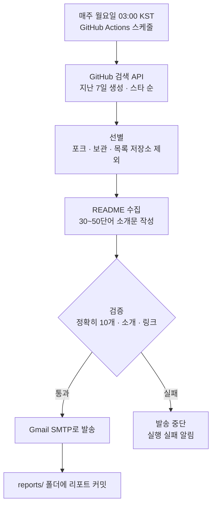

# GitHub 주간 신규 인기 프로그램 TOP 10 메일러

매주 **월요일 오전 3시(KST)**, 지난 7일 동안 새로 만들어진 GitHub 저장소 중 스타를 가장 많이 받은 프로그램 **10개**를 골라 이메일로 보내는 자동화입니다. GitHub Actions에서 동작하므로 PC나 서버를 켜 둘 필요가 없습니다.

## 한눈에 보기

| 항목 | 내용 |
| --- | --- |
| 실행 시각 | 매주 월요일 03:00 KST — `cron: '0 3 * * 1'` + `timezone: 'Asia/Seoul'` |
| 집계 대상 | 실행 시점 기준 지난 7일 동안 생성된 공개 저장소, 스타 수 내림차순 |
| 발송 개수 | 정확히 10개 (10개를 채우지 못하면 메일을 보내지 않고 실행을 실패 처리) |
| 항목 구성 | 프로그램 이름 · 30~50단어 소개 · 공식 링크(GitHub 저장소 URL, 홈페이지가 있으면 함께 표기) |
| 발신 주소 | `MAIL_FROM` Secret에 등록한 Gmail 주소 (Gmail SMTP + 앱 비밀번호) |
| 수신 주소 | `MAIL_TO` Secret에 등록한 주소 (여러 명이면 쉼표로 구분) |
| 비용 | GitHub Actions 무료 한도 안에서 동작 (1회 1~2분). Claude 요약은 선택 기능 |

## 동작 방식



1. **수집** — GitHub 검색 API로 `created:<7일 전>..<지금>` 조건의 공개 저장소를 스타 수 순으로 100개씩 가져옵니다.
2. **선별** — 프로그램이 아닌 저장소(포크, 보관됨, 코드 언어 미검출, `awesome-*` 목록 등)를 거르고 위에서부터 10개를 고릅니다.
3. **소개문** — 저장소 설명·README 첫 문단·통계로 30~50단어 소개문을 만듭니다. `ANTHROPIC_API_KEY`를 등록하면 Claude가 README를 읽고 한국어로 요약합니다.
4. **검증** — 정확히 10개인지, 모든 항목에 이름·30~50단어 소개·`https://github.com/…` 링크가 있는지 확인합니다. 하나라도 어긋나면 메일을 보내지 않고 실행을 실패로 끝냅니다. 스케줄 실행이 실패하면 GitHub가 워크플로를 마지막으로 수정한 사용자에게 알림 메일을 보냅니다.
5. **발송·보관** — HTML과 텍스트(마크다운) 본문을 함께 담아 보내고, `reports/YYYY-MM-DD.md`로 저장소에 커밋합니다. 실행 화면의 Summary와 Artifacts에서도 결과를 볼 수 있습니다.

## 저장소 구조

```text
github-weekly-trends/
├── .github/
│   └── workflows/
│       └── weekly-trends.yml   # 스케줄(매주 월요일 03:00 KST)과 실행 단계
├── scripts/
│   └── weekly_trends.py        # 수집 → 선별 → 소개문 → 검증 → 발송
├── tests/
│   └── test_weekly_trends.py   # 단위 테스트 48개 (네트워크 불필요)
├── docs/
│   └── sample/                 # 실제 데이터로 만든 메일 미리보기
├── reports/                    # 매주 자동 커밋되는 리포트 (첫 실행 때 생성)
├── .env.example                # 로컬 실행용 설정 예시
├── .gitignore
└── requirements.txt            # anthropic (Claude 요약 선택 기능용)
```

## 설정 가이드

### 1단계. Gmail 앱 비밀번호 만들기

Gmail은 일반 비밀번호로 SMTP 로그인을 허용하지 않으므로 발신 계정의 **앱 비밀번호**가 필요합니다.

1. 메일을 보낼 Gmail 계정으로 로그인한 뒤 [Google 계정 보안 설정](https://myaccount.google.com/security)에서 **2단계 인증**을 켭니다.
2. [앱 비밀번호](https://myaccount.google.com/apppasswords) 페이지에서 앱 이름(예: `github-weekly-trends`)을 입력하고 **만들기**를 누릅니다.
3. 표시된 16자리 비밀번호를 복사해 둡니다. 창을 닫으면 다시 볼 수 없습니다.

> 앱 비밀번호는 이 메일러 전용으로만 쓰세요. 노출되었다면 같은 페이지에서 삭제하고 새로 만들면 됩니다.

### 2단계. GitHub 저장소 만들기

1. [새 저장소 만들기](https://github.com/new) 화면에서 저장소 이름을 `github-weekly-trends`로 입력합니다.
2. 공개 범위를 고릅니다. 메일 주소와 비밀번호는 어느 쪽이든 Secrets에만 저장되어 저장소에 드러나지 않습니다.
   - **Public**: Actions 실행 시간이 무료이고, 매주 쌓이는 `reports/` 리포트를 누구나 볼 수 있습니다. 공개 저장소는 60일 동안 활동이 없으면 스케줄이 멈출 수 있는데, 이 워크플로는 매주 리포트를 커밋해 활동을 이어 갑니다.
   - **Private**: 리포트를 비공개로 둡니다. 주 1회 1~2분 실행이라 무료 플랜 한도(월 2,000분)로 충분합니다.
3. README·.gitignore 추가 옵션은 체크하지 않고 **Create repository**를 누릅니다.

### 3단계. 파일 올리기

**방법 A — 웹 브라우저 (설치 불필요)**

1. 새 저장소 첫 화면에서 **uploading an existing file** 링크를 누릅니다.
2. 이 폴더(`github-weekly-trends`) 안의 파일과 폴더를 **모두** 끌어다 놓습니다. `.github` 폴더가 빠지면 자동 실행이 되지 않습니다.
3. **Commit changes**를 누릅니다.
4. 저장소에 `.github/workflows/weekly-trends.yml`이 보이는지 확인합니다. 없다면 **Add file → Create new file**에서 파일 이름에 `.github/workflows/weekly-trends.yml`을 입력하고 내용을 붙여 넣은 뒤 커밋합니다.

**방법 B — Git 명령어**

```bash
cd github-weekly-trends
git init -b main
git add .
git commit -m "Add weekly GitHub trends mailer"
git remote add origin https://github.com/<사용자명>/github-weekly-trends.git
git push -u origin main
```

Windows에 Git이 없다면 `winget install --id Git.Git -e`로 설치할 수 있습니다.

### 4단계. Actions Secrets 등록

저장소의 **Settings → Secrets and variables → Actions → New repository secret**에서 아래 값을 등록합니다.

| Secret 이름 | 값 | 필수 여부 |
| --- | --- | --- |
| `MAIL_FROM` | 보내는 Gmail 주소 (1단계에서 앱 비밀번호를 만든 계정) | 필수 |
| `MAIL_TO` | 받는 사람 이메일 주소. 여러 명이면 `a@example.com,b@example.com`처럼 쉼표로 구분 | 필수 |
| `GMAIL_APP_PASSWORD` | 1단계에서 만든 16자리 앱 비밀번호 (공백이 섞여 있어도 자동 제거) | 필수 |
| `ANTHROPIC_API_KEY` | Claude API 키. 등록하면 Claude가 README를 읽고 한국어 소개문을 작성 | 선택 |

- `GITHUB_TOKEN`은 Actions가 자동으로 만들어 주므로 따로 등록하지 않습니다.
- 메일 주소를 Secret으로 두면 실행 로그에서도 자동으로 가려집니다.

### 5단계. 수동 실행으로 테스트

1. 저장소의 **Actions** 탭에서 **Weekly GitHub Trends** 워크플로를 선택하고 **Run workflow**를 누릅니다.
2. 처음에는 `dry_run`을 체크하고 실행합니다. 메일은 보내지 않으며, 실행 화면의 **Summary**에 이번 주 TOP 10이 표시되고 **Artifacts**에서 HTML 본문을 내려받을 수 있습니다.
3. 결과가 괜찮으면 `dry_run`을 끄고 다시 실행해 실제로 메일이 오는지 확인합니다. 받은편지함에 없으면 스팸함도 확인하세요.

### 6단계. 자동 실행 확인

- 워크플로 파일이 **기본 브랜치**(`main`)에 있으면 다음 월요일 03:00(KST)부터 자동으로 실행됩니다.
- 실행 기록은 **Actions** 탭에서, 주간 리포트 아카이브는 저장소의 `reports/` 폴더에서 볼 수 있습니다.

## 스케줄 설정

`.github/workflows/weekly-trends.yml`의 스케줄 부분입니다.

```yaml
on:
  schedule:
    # 분 시 일 월 요일 → 매주 월요일(1) 03:00
    - cron: '0 3 * * 1'
      timezone: 'Asia/Seoul'   # 한국 표준시(KST) 기준. 생략하면 UTC로 해석됩니다.
  workflow_dispatch:           # Actions 탭의 'Run workflow' 버튼으로 수동 실행(테스트용)
```

| 필드 | 값 | 의미 |
| --- | --- | --- |
| 분 | `0` | 정각 |
| 시 | `3` | 오전 3시 |
| 일 | `*` | 매일 |
| 월 | `*` | 매월 |
| 요일 | `1` | 월요일 (0 = 일요일) |
| `timezone` | `Asia/Seoul` | 위 시각을 한국 표준시(UTC+9)로 해석 |

알아 둘 점:

- `timezone` 키는 2026년 3월 GitHub Actions에 추가된 기능입니다. 지원하지 않는 환경(구버전 GitHub Enterprise Server 등)에서는 `timezone` 줄을 지우고 UTC로 환산한 `cron: '0 18 * * 0'`(일요일 18:00 UTC = 월요일 03:00 KST)을 쓰세요.
- GitHub Actions 스케줄은 매시 정각처럼 실행이 몰리는 시간대에 수 분에서 수십 분 늦게 시작될 수 있고, 부하가 매우 크면 드물게 건너뛰기도 합니다. 정시성이 더 중요하다면 `'5 3 * * 1'`처럼 몇 분 늦춰 두는 편이 안전합니다.
- 공개 저장소는 60일 동안 활동이 없으면 스케줄이 자동으로 꺼집니다. 이 워크플로는 매주 리포트를 커밋해 활동을 이어 가지만, 꺼졌다면 Actions 탭에서 **Enable workflow**를 누르면 됩니다.
- 스케줄 실행은 항상 기본 브랜치의 최신 커밋을 기준으로 합니다.

## 이메일 내용

- **제목:** `[GitHub 주간 트렌드] 2026-11-30 신규 인기 프로그램 TOP 10`
- **본문:** HTML(메일 앱에 보이는 카드형 본문)과 텍스트(마크다운) 두 형식을 함께 보냅니다.
- **항목:** 순위 · 프로그램 이름 · 메타 정보(스타, 포크, 언어, 생성일, 토픽) · 30~50단어 소개 · 공식 링크(+ 홈페이지)

실제 데이터(2026-11-18 ~ 2026-11-25)로 만든 미리보기: [마크다운](docs/sample/2026-11-25.md) · [HTML](docs/sample/2026-11-25.html)

항목 예시 (템플릿 소개문, 43단어):

> **4. xnulinux**
>
> `AFK-surf/xnulinux` · ★ 3,590 · 포크 168 · Objective-C++ · 2026-11-20 생성
>
> Objective-C++ 기반 오픈소스 프로젝트로, 11월 20일 GitHub에 공개되었습니다. 저장소 설명은 "XNU as a loadable kernel module inside Linux (macOS personality for arm64 Linux)"입니다. README에서는 "Run macOS userspace on Linux by loading the macOS kernel into it"라고 소개합니다. 현재까지 스타 3,590개와 포크 168개를 기록했습니다.
>
> - 공식 링크: <https://github.com/AFK-surf/xnulinux>

## 선정 기준과 품질 장치

| 단계 | 규칙 |
| --- | --- |
| 기간 | 실행 시점 기준 직전 7일(168시간) 안에 생성된 공개 저장소 |
| 정렬 | GitHub 스타 수 내림차순 |
| 제외 | 포크, 보관(archived) 저장소, 코드 언어가 검출되지 않은 문서·목록 저장소, `awesome-*`·큐레이션 목록, 설명과 README 본문이 모두 없는 저장소 |
| 다양성 | 같은 소유자(계정·조직)의 저장소는 최대 2개 (`MAX_PER_OWNER`) |
| 검증 | 정확히 10개, 이름·30~50단어 소개·`https://github.com/…` 링크 존재, 중복 없음. 하나라도 어긋나면 발송하지 않음 |

- **단어 수 기준:** 띄어쓰기로 구분된 어절을 1단어로 셉니다. 기호만 있는 토큰(—, ★ 등)은 세지 않고, 띄어쓰기가 없는 한자·가나는 2글자를 1단어로 셉니다.
- **안전 문구:** 스타 수는 조작될 수 있고 급상승 저장소가 악성코드 유포에 쓰이기도 하므로, 메일 하단에 "안전성을 보증하지 않으니 내려받기 전에 출처를 확인하라"는 안내가 들어갑니다.

## 소개문 생성 방식

| 방식 | 사용 조건 | 특징 |
| --- | --- | --- |
| 템플릿 (기본) | 항상 사용 가능 | 언어·공개일·저장소 설명·README 첫 문단·스타/포크 수로 30~50단어 문단을 구성합니다. 외부 API와 비용이 없고, 원문 설명은 영어 그대로 인용됩니다. |
| Claude 요약 (선택) | `ANTHROPIC_API_KEY` Secret 등록 | Claude(`claude-opus-5-5`)가 README를 읽고 무엇을 하는 프로그램인지, 어떤 특징이 있는지, 누구에게 유용한지를 한국어 2~3문장으로 요약합니다. |

Claude 요약의 세부 동작:

- 결과가 30~50단어를 벗어나면 한 번 더 요청하고, 그래도 맞지 않거나 API 오류·거절이 나면 해당 항목만 템플릿으로 대체합니다. 키가 잘못되었으면 그 주는 모두 템플릿으로 보냅니다(메일은 정상 발송).
- 요청에 서버 측 대체 모델 옵션(`fallbacks: "default"`)을 켜 두어, 안전 분류기가 요청을 거절하면 다른 모델이 이어서 답합니다.
- README는 분석할 데이터로만 다루도록 지시하고, 출력에서 URL을 제거합니다(README 속 프롬프트 주입 대비).
- README는 최대 2만 자까지만 전달합니다(넘으면 로그에 기록). 주 10~20회 호출이며, Claude Opus 5.5 요금(100만 토큰당 입력 $4 / 출력 $20) 기준으로 주당 0.5달러 안팎으로 추정됩니다. 모델과 추론 강도는 `ANTHROPIC_MODEL`, `ANTHROPIC_EFFORT`로 바꿀 수 있습니다.

## 환경 변수

| 변수 | 기본값 | 설명 |
| --- | --- | --- |
| `MAIL_FROM` | 없음 | 보내는 Gmail 주소 (필수) |
| `MAIL_TO` | 없음 | 받는 주소, 쉼표로 여러 개 지정 가능 (필수) |
| `SMTP_PASSWORD` | 없음 | Gmail 앱 비밀번호 (필수). Actions에서는 `GMAIL_APP_PASSWORD` Secret과 연결됨 |
| `SMTP_HOST` | `smtp.gmail.com` | 다른 SMTP 서버를 쓸 때 변경 |
| `SMTP_PORT` | `465` | 465는 SSL, 그 밖의 포트(예: 587)는 STARTTLS |
| `SMTP_USERNAME` | `MAIL_FROM` 값 | SMTP 로그인 아이디가 발신 주소와 다를 때 지정 |
| `GITHUB_TOKEN` | Actions 자동 제공 | GitHub API 인증 (로컬에서는 선택) |
| `ANTHROPIC_API_KEY` | 없음 | 설정하면 Claude 요약 사용 |
| `ANTHROPIC_MODEL` | `claude-opus-5-5` | Claude 모델 |
| `ANTHROPIC_EFFORT` | `medium` | 추론 강도 (`low`, `medium`, `high`, `xhigh`, `max`) |
| `MAX_PER_OWNER` | `2` | 같은 소유자 저장소 최대 개수 (`0`이면 제한 없음) |
| `REQUIRE_LANGUAGE` | `true` | 코드 언어가 검출된 저장소만 포함 |
| `EXCLUDE_KEYWORDS` | 없음 | 이름·설명에 포함되면 제외할 단어, 쉼표로 구분 (예: `gta,proxy`) |
| `DRY_RUN` | `false` | `true`면 메일을 보내지 않고 리포트만 생성 |
| `REPORT_DIR` | `reports` | 리포트 저장 폴더 |

Actions에서 값을 바꾸려면 워크플로의 발송 단계 `env:` 블록에 추가합니다.

```yaml
      - name: Collect weekly top 10 and send email
        env:
          # ...기존 값은 그대로 두고 아래처럼 추가...
          EXCLUDE_KEYWORDS: 'gta,proxy'
          MAX_PER_OWNER: '1'
```

## 로컬 실행과 외부 스케줄러 (선택)

GitHub Actions 대신 PC나 서버에서 직접 실행할 수도 있습니다. Python 3.10 이상이 필요합니다.

```powershell
cd github-weekly-trends
copy .env.example .env                       # 메모장으로 열어 MAIL_FROM, MAIL_TO, SMTP_PASSWORD 입력
python -m unittest discover -s tests         # 단위 테스트
python scripts/weekly_trends.py --dry-run    # 메일 없이 reports/ 에 결과만 생성
python scripts/weekly_trends.py              # 실제 발송
```

Claude 요약을 쓰려면 먼저 `pip install -r requirements.txt`를 실행합니다.

**Windows 작업 스케줄러** — 매주 월요일 03:00에 실행:

```powershell
$dir = "C:\경로\github-weekly-trends"
$action = New-ScheduledTaskAction -Execute (Get-Command python).Source -Argument "scripts\weekly_trends.py" -WorkingDirectory $dir
$trigger = New-ScheduledTaskTrigger -Weekly -DaysOfWeek Monday -At 3am
$settings = New-ScheduledTaskSettingsSet -WakeToRun -StartWhenAvailable
Register-ScheduledTask -TaskName "GitHubWeeklyTrends" -Action $action -Trigger $trigger -Settings $settings
```

PC가 켜져 있거나 절전 상태여야 하며(절전이면 깨워서 실행), 기본 설정에서는 사용자가 로그인되어 있어야 합니다. 로그아웃 상태에서도 돌리려면 작업 스케줄러에서 "사용자의 로그온 여부에 관계없이 실행"을 선택하세요.

**Linux 서버 cron** — `crontab -e`에 추가:

```bash
CRON_TZ=Asia/Seoul
0 3 * * 1 cd /path/to/github-weekly-trends && /usr/bin/python3 scripts/weekly_trends.py >> weekly.log 2>&1
```

`CRON_TZ`는 대부분의 Linux(cronie)에서 지원합니다. 지원하지 않는 cron이고 서버 시간대가 UTC라면 `0 18 * * 0`을 사용하세요.

## 문제 해결

| 증상 | 확인할 것 |
| --- | --- |
| `Gmail 로그인에 실패했습니다` | 발신 계정의 2단계 인증이 켜져 있는지, `GMAIL_APP_PASSWORD`가 일반 비밀번호가 아닌 앱 비밀번호인지 |
| `메일 발송에 필요한 설정이 없습니다` | Secret 이름 오타 (`MAIL_FROM`, `MAIL_TO`, `GMAIL_APP_PASSWORD`) |
| `선정된 프로그램이 N개입니다` | `EXCLUDE_KEYWORDS`, `MAX_PER_OWNER`를 너무 엄격하게 설정하지 않았는지 |
| 메일이 오지 않음 | 받은편지함의 스팸·프로모션 폴더, 회사 메일 서버의 외부 메일 차단 정책 |
| 월요일 3시가 지났는데 실행 기록이 없음 | 워크플로 파일이 기본 브랜치에 있는지, 워크플로가 비활성화되지 않았는지, 스케줄 지연(수십 분) 여부 |
| `Commit report to repository` 단계 경고 | 기본 브랜치 보호 규칙이 봇의 푸시를 막고 있는지 확인. 메일 발송에는 영향 없음 |
| Claude 요약 대신 템플릿이 쓰임 | 실행 로그의 경고 메시지 (API 키 오류, 사용량 한도 등) |

## 바꾸고 싶을 때

- **발송 시각:** `cron` 값을 수정합니다. 예: 매주 월요일 오전 9시 → `'0 9 * * 1'`
- **받는 사람:** `MAIL_TO` Secret을 수정합니다. 여러 명이면 쉼표로 구분합니다.
- **개수·기간·소개문 길이:** `scripts/weekly_trends.py` 맨 위의 `TOP_N`, `WINDOW_DAYS`, `MIN_WORDS`, `MAX_WORDS`를 바꿉니다. 현재 값(10개, 7일, 30~50단어)은 요구사항에 맞춘 것이며, 바꾸면 `tests/`의 테스트도 함께 수정해야 합니다.
